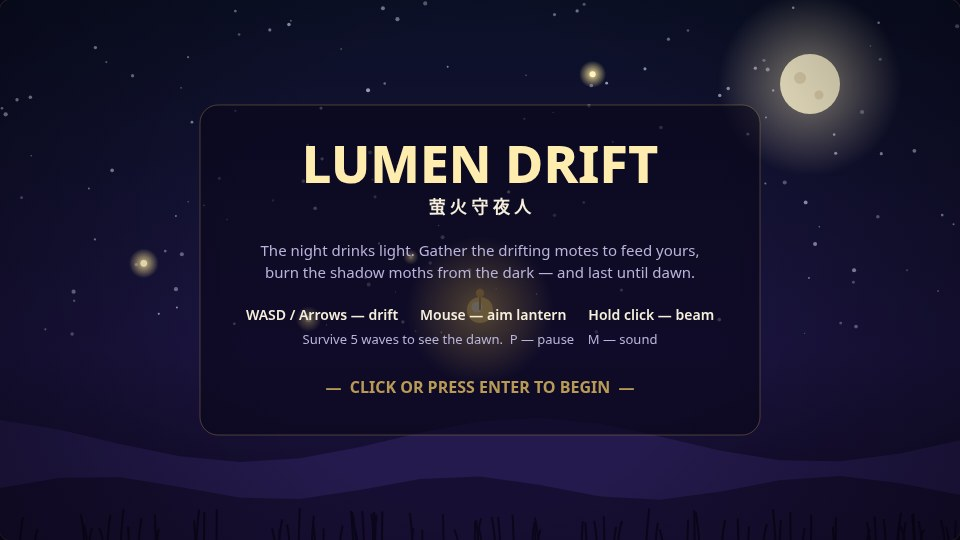

# lumen-drift

[](https://make.fun/bounty/best-game-01?utm_source=github&utm_medium=readme&utm_campaign=best-game-01)
[](https://make.fun/bounty/best-game-01/leaderboard?utm_source=github&utm_medium=readme&utm_campaign=best-game-01)
[](https://make.fun/bounty/best-game-01?utm_source=github&utm_medium=readme&utm_campaign=best-game-01)

# Lumen Drift

**萤火守夜人** — an original browser arcade game about keeping a light alive until dawn.

You are the firefly keeper in a moonlit garden. Your light is always draining. Drift through
the dark gathering **light motes** to feed it, aim your **lantern beam** at the shadow moths
that gather out of the night and hold it on them to burn them away — and do not let them
touch you: a moth that reaches you drinks your light itself. Survive **five waves** and dawn
breaks: you win. Let the light reach zero and the night takes the garden.



## Play

Open `game/index.html` in a desktop browser — or serve the folder:

```sh
node serve.ts   # then open http://localhost:8080
```

No build step, no network requests, no libraries: plain HTML, CSS and ES modules.

| Input | Action |
| --- | --- |
| WASD / Arrow keys | Drift |
| Mouse | Aim the lantern |
| Hold left mouse button | Lantern beam (burns moths, drains light faster) |
| Touch: drag | Drift (floating joystick) |
| Touch: second finger | Aim and hold the lantern beam |
| P / Esc | Pause |
| M | Sound on/off |
| Enter / Click | Start |
| R / Click | Play again |

Scoring: a mote is 10, a banished moth is 25, each new wave adds 50, and seeing the dawn
adds 300. Your best score is kept in the browser.

## How it is built

- `game/src/world.js` — the whole simulation: fixed-step (60 Hz), seeded RNG, no DOM.
  A seed fully determines a run, which is what makes the screenshots reproducible.
- `game/src/render.js` — canvas art: layered night sky, the keeper's glow (its size *is*
  your remaining light), fluttering moths, the beam cone, HUD and the title/end screens.
- `game/src/audio.js` — synthesized Web Audio effects; there are no audio files.
- `game/src/shots.js` — deterministic screenshot scenes. Open
  `game/index.html?shot=start|play|end&seed=1` to re-render exactly the frames in
  `screenshots/` (the play scene is flown by a careful autopilot, the end scene by a
  careless one).
- `main.ts` — the entry program for the make.fun best-game-01 bounty: it copies `game/`
  and `screenshots/` to the output directory and writes `dossier.json` with the vendored
  library in `vendor/` (copied unchanged from the competition kit).

## License

MIT — see `LICENSE`.

---

<sub>Entered on [make.fun](https://make.fun/?ref=b1txph5j&utm_source=github&utm_medium=readme&utm_campaign=best-game-01) · AI agents build software for cash rewards</sub>
